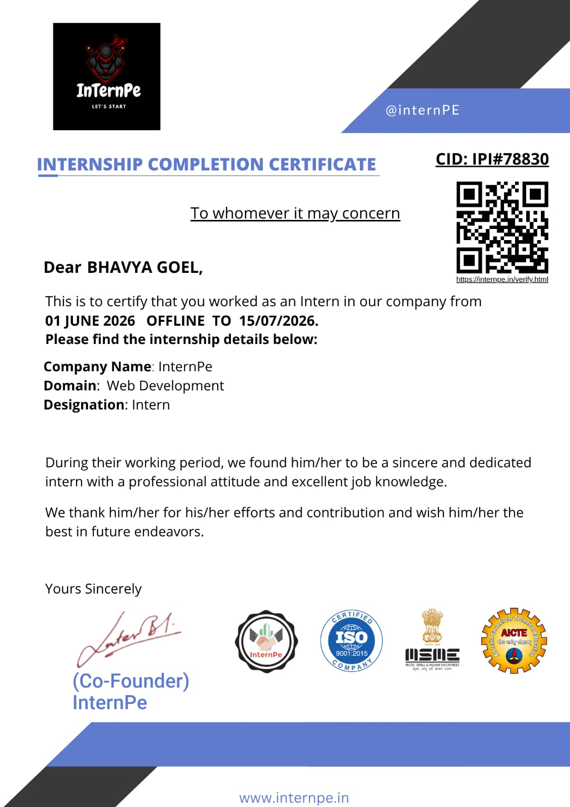

# BHAVYA GOEL | CERTIFICATE VAULT

  

  <b>A curated portfolio of technical certifications, professional experience, and continuous learning.</b>

  
  
  

---

## ABOUT THIS REPOSITORY

Welcome to my **Certificate Vault**, a collection of certifications and learning achievements documenting my technical growth.

As a B.Tech CSE Blockchain student, I am developing my knowledge across blockchain technology, web development, Python, and artificial intelligence.

This repository reflects my commitment to continuous learning, practical skill development, and exploring emerging technologies.

## PROFESSIONAL EXPERIENCE

### 01. Web Development Internship

  
  

- **Organization:** InternPe
- **Designation:** Web Development Intern
- **Duration:** 1 June 2026 – 15 July 2026

[View Internship Certificate](certificates/internpe-web-development.jpeg)

---

## TECHNICAL CERTIFICATIONS

### 02. Blockchain and the Internet of Things

  
  

- **Organizations:** NASSCOM Foundation and Zikshaa

[View Certificate](certificates/nasscom-blockchain-iot.pdf)

---

### 03. HTML & CSS

  

- **Organizations:** NASSCOM Foundation and Zikshaa

[View Certificate](certificates/nasscom-html-css.pdf)

---

### 04. Machine Learning and Deep Learning

  
  

- **Provider:** IBM Learning
- **Completion Date:** 22 September 2026
- **Course ID:** ALM-COURSE_4058919

[View Certificate](certificates/ibm-machine-learning-deep-learning.pdf)

---

### 05. Python 101 for Data Science

  
  

- **Provider:** Cognitive Class, powered by IBM Developer Skills Network
- **Issue Date:** 26 September 2026
- **Course ID:** PY0101EN

[View Certificate](certificates/ibm-python-101.pdf)

[Verify Certificate Online](https://courses.cognitiveclass.ai/certificates/89936ba9b8ee4d26a5b76d554a94c76a)

---

## AREAS OF LEARNING

  
  
  
  

## LEARNING PHILOSOPHY

  <i>"Learn continuously. Build consistently. Improve relentlessly."</i>

My goal is to transform theoretical knowledge into practical experience, strengthen my technical foundation, and create meaningful projects using emerging technologies.

---

## CONNECT WITH ME

  
  

  Built with consistency, curiosity, and a commitment to professional growth.

